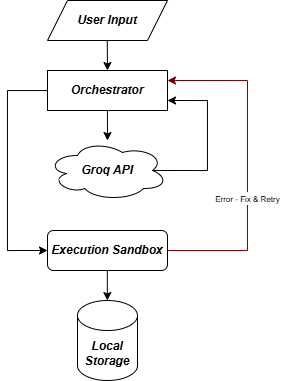

<div align="center">

# 🤖 Autonomous ML-Ops Agent

### *AI training AI.* Describe the model you want. The agent builds, runs, and fixes the pipeline itself.

[](LICENSE)
[](https://www.python.org/downloads/)
[](https://groq.com/)
[](#-contributing)

</div>

---

## 🌌 Vision

Machine Learning pipelines are still assembled by hand: find a dataset, wire up a training script, run it, read the stack trace, patch, repeat.

**Autonomous ML-Ops Agent** removes the human from that loop. You give it a plain-English prompt. It pulls the dataset from **Roboflow**, writes a **YOLO** training script, executes it on your machine, and when the code breaks, it reads its own error output and fixes itself until the run succeeds.

> One prompt in. A trained model out. No babysitting.

---

## 🏗️ System Architecture



The agent follows a **ReAct (Reason + Act)** pattern built from four cooperating components:

| Component | Role |
|---|---|
| **Orchestrator** | The central Python traffic controller. Receives user input, routes work between the LLM and the sandbox, and manages the retry loop. |
| **Groq Brain** | A high-speed LLM (Llama-3 via the Groq API) that converts natural-language intent into executable Python code, and rewrites that code when it fails. |
| **Execution Sandbox** | Uses Python's `subprocess` to run AI-generated code on the local machine and capture `stdout` / `stderr`. |
| **Local Workspace** | A git-ignored folder where downloaded datasets and generated scripts are saved. |

### The ReAct Flow

1. **User Input**: you describe the task in plain English.
2. **Reason**: the Orchestrator sends the request to the Groq Brain, which returns Python code.
3. **Act**: the Orchestrator hands the code to the Execution Sandbox, which runs it via `subprocess`.
4. **Observe**: results and artifacts are written to local storage. If execution fails, `stderr` is captured.
5. **Self-Heal**: the error is routed back to the Orchestrator, which asks the Groq Brain to fix the code. The loop retries until the run succeeds.

---

## ✨ Key Features

### 🚀 Zero-Touch Pipeline
Go from a sentence to a running training job without writing a line of code. The agent handles:
- Fetching datasets from **Roboflow**
- Writing **YOLO** training scripts
- Executing those scripts locally

### 🔁 The Self-Healing Loop *(the killer feature)*
Most code generators stop at the first traceback. This one doesn't.

```
 Sandbox error (stderr)
        │
        ▼
 Orchestrator  ──►  Groq Brain: "Here's the code and the error. Fix it."
        ▲                         │
        └──────── patched code ◄──┘   →  re-run in Sandbox  →  repeat until success
```

When the sandbox hits an execution error, the `stderr` output is fed back through the Orchestrator to the Groq Brain, which returns corrected code. The Orchestrator re-runs it, and the cycle continues until the pipeline completes.

### ⚡ Fast Reasoning
Llama-3 on Groq's inference stack keeps each generate → fix iteration quick, so retries don't stall the pipeline.

### 🗂️ Clean, Reproducible Workspace
Every dataset and generated script is saved to a dedicated, git-ignored workspace folder, so you can inspect exactly what the agent wrote and ran.

---

## 📁 Folder Structure

```text
autonomous-mlops-agent/
├── src/                    # Core source code
│   ├── main.py             # Entry point (CLI prompt → Orchestrator)
│   ├── orchestrator.py     # Central controller & self-healing loop logic
│   ├── brain.py            # Groq API client (prompt → Python code / fixes)
│   └── sandbox.py          # subprocess-based execution & stderr capture
├── workspace/              # Git-ignored: datasets & AI-generated scripts
├── assets/
│   └── architecture.png    # System architecture diagram
├── .env.example            # Template for required environment variables
├── .gitignore
├── requirements.txt
├── LICENSE
└── README.md
```

> 📝 This layout is the intended project structure. Adjust file names to match your codebase as it evolves.

---

## 🚀 Getting Started

### Prerequisites
- **Python 3.10+**
- A **[Groq API key](https://console.groq.com/)**
- A **[Roboflow API key](https://roboflow.com/)** (for dataset fetching)

### 1. Clone the repository
```bash
git clone https://github.com/<your-username>/autonomous-mlops-agent.git
cd autonomous-mlops-agent
```

### 2. Create a virtual environment & install dependencies
```bash
python -m venv .venv
source .venv/bin/activate        # Windows: .venv\Scripts\activate
pip install -r requirements.txt
```

### 3. Configure your environment
Copy the template and add your keys:
```bash
cp .env.example .env
```

```env
# .env
GROQ_API_KEY=your_groq_api_key_here
ROBOFLOW_API_KEY=your_roboflow_api_key_here
```

> 🔒 `.env` is git-ignored. Never commit your keys.

### 4. Run the agent
```bash
python src/main.py
```
Then give it a prompt, for example:

```text
> Download a hard-hat detection dataset from Roboflow and train a YOLO model on it.
```

Watch the Orchestrator generate the code, run it in the sandbox, and heal any errors along the way. Generated scripts and datasets will appear in `workspace/`.

---

## ⚠️ A Note on Safety

The Execution Sandbox runs **AI-generated code on your local machine** through Python's `subprocess`. It is not a hardened, isolated container. Review the scripts saved in `workspace/`, and consider running the agent inside a VM, container, or disposable environment, especially when experimenting.

---

## 🤝 Contributing

**We're actively looking for Pull Requests!** Whether you're fixing a bug, improving the self-healing loop, or tightening up the sandbox, contributions are welcome.

1. **Fork** the repository
2. **Create** a feature branch: `git checkout -b feature/your-idea`
3. **Commit** your changes: `git commit -m "Add your idea"`
4. **Push** to your branch: `git push origin feature/your-idea`
5. **Open a Pull Request** and tell us what you built and why

Good places to start: open issues, error-handling edge cases in the retry loop, prompt improvements for the Groq Brain, and documentation.

---

## 📄 License

Distributed under the **MIT License**. See [`LICENSE`](LICENSE) for details.

---

<div align="center">

**If this project sparks something for you, give it a ⭐ and help us teach AI to train AI.**

</div>